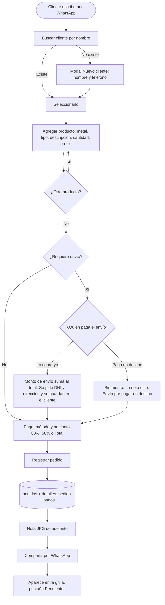
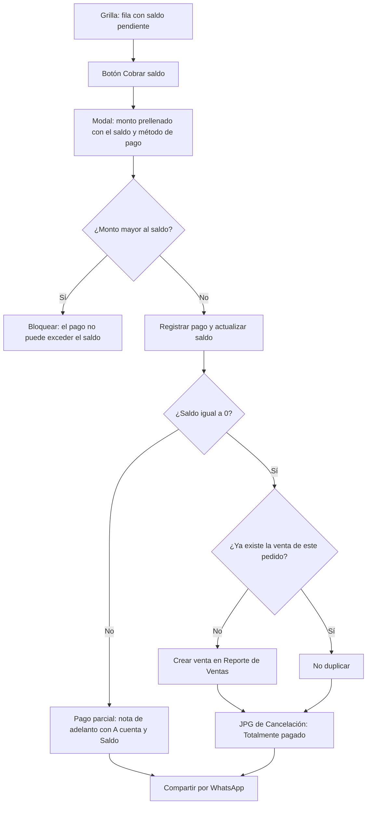
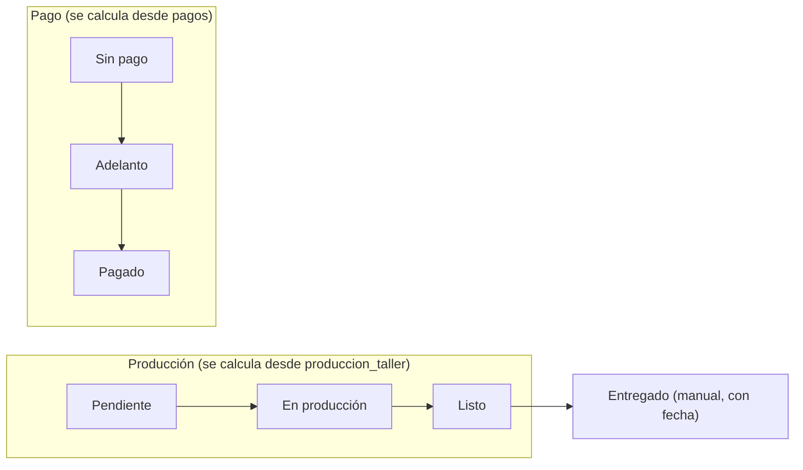
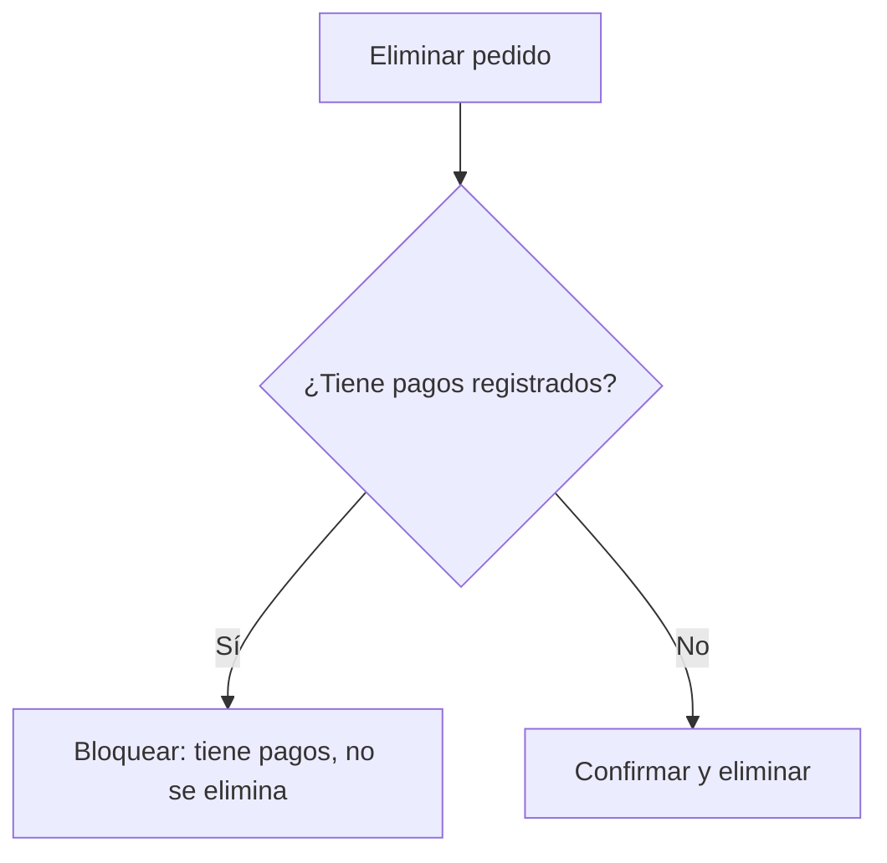

# Manual técnico: Módulo de Pedidos (Enigma ERP)

Versión sobre **Neon** (la migración a Supabase queda para después).
Principio guía: **menos es más**. Ingreso rápido, pocos campos, un solo lugar para cada dato.

> **Cómo se usa este manual:** se trabaja por **fases**. Terminas una, pruebas con el checklist, me confirmas y pasamos a la siguiente. Cada fase indica qué archivos se tocan y qué archivos adicionales necesito de ti.

---

## 1. Resumen: flujo actual vs. flujo mejorado

| Tema | Hoy | Mejorado | Por qué |
|---|---|---|---|
| Datos del cliente al registrar | Nombre + teléfono (el teléfono siempre queda de solo lectura) + DNI sin campo en pantalla | Nombre + teléfono (solo en el modal de cliente nuevo). DNI y dirección solo si hay envío | Ingreso más corto; ya obligas a elegir cliente |
| IGV | Casilla + 3 columnas | Se elimina de la pantalla | En el export, `incluye_igv` es false en todos los pedidos |
| Envío | 3 opciones (En destino / Ya pagado / Pendiente) | 2 opciones: **Lo cobro yo** (monto) / **Paga en destino** | "Pendiente" es lo mismo que "lo cobro yo" con saldo |
| Método de pago | Efectivo, Yape, Plin, Transferencia | **Efectivo, Billetera digital, Transferencia** | La captura del Yape ya queda en tu celular |
| Adelanto | Se escribe a mano | Botones **80% / 50% / Total** + monto editable | Es tu práctica habitual |
| Cobro del saldo (cancelación) | Se hace en el **Reporte**, y en Pedidos solo en la pestaña Listos | Botón **Cobrar saldo** en el módulo de Pedidos, en toda fila con saldo | Debe vivir donde trabajas |
| Nota JPG | Una sola, encabezado largo, subtotal repetido, etiqueta "Completado" confusa | Dos variantes: **Adelanto** y **Cancelación** | Que no redunde |
| Grilla | Debajo del formulario, la tabla repetida 3 veces | Pantalla principal con buscador; el formulario se abre con **+ Nuevo pedido** | Menos scroll, menos código |
| Estados | `estado_pedido`, `estado_produccion`, `cancelado`, `entregado` | Pago y producción se **derivan**; solo `estado_pedido` (aceptado/entregado) es manual | Una sola fuente de verdad |

---

## 2. Cómo opera hoy (según tu relato y tu código)

1. Alguien te escribe y pide una o más piezas.
2. Registras nombre y teléfono (eliges o creas el cliente desde un **modal**; antes había que ir al módulo de clientes).
3. Agregas productos uno a uno (metal, tipo, descripción, cantidad, precio) y se arma la lista con subtotal.
4. Marcas IGV (no lo usas) y envío.
5. Registras el adelanto (`monto_a_cuenta`) y se crea un pago en la tabla `pagos`.
6. Se genera la nota JPG (modal "Vista previa" → compartir) y la envías por WhatsApp.
7. El pedido aparece en la grilla: Pendientes → Producción → Listos. Desde ahí vas a producción (`/produccion?pedido=ID`).
8. Al cobrar el saldo hoy se hace en el Reporte de Pedidos, y casi no envías comprobante de cancelación.
9. Al entregar, `handleEntregar` exige producción terminada y marca `estado_pedido = 'entregado'`.

---

## 3. Auditoría

### 3.1 Qué está bien
- Modal de cliente nuevo dentro de Pedidos; obliga a elegir cliente existente.
- Detalles de pedido y pagos en tablas separadas; saldo calculado.
- La venta se registra en Ventas al quedar saldo 0.

### 3.2 Errores reales (corregir primero)
| # | Problema | Dónde |
|---|---|---|
| E1 | `toast.warning` **no existe** en react-hot-toast: si falta metal o tipo, el botón "+" lanza error en vez de avisar | `Pedidos.jsx`, `agregarProducto` |
| E2 | **Origen no se guarda**: el INSERT/UPDATE no incluye `origen_pedido`; en el export todos son INTERNET | `pedidosNeonClient.js`, `create` y `update` |
| E3 | Al **editar** un pedido cambia `monto_a_cuenta` pero **no se crea el pago** en `pagos` → descuadre. La venta se crea una sola vez y no se actualiza si cambia el total | `Pedidos.jsx`, `handleSubmit` |
| E4 | `handleDelete` borra pedido, pagos y venta: un pedido con adelanto cobrado desaparece de tu historial de ingresos | `Pedidos.jsx` |
| E5 | `productoActual` inicia sin `metal` ni `tipo_producto`: los selects empiezan sin valor controlado | `Pedidos.jsx` |
| E6 | Tolerancia del saldo inconsistente: 0.10 en el formulario, 0.05 en pago rápido, 0.1 y 0.05 en el reporte | `Pedidos.jsx`, `ReportePedidos.jsx` |
| E7 | Doble clic en "Confirmar pago" puede crear **dos pagos** (no hay bloqueo mientras guarda) | Modal de pago |
| E8 | Hay filtro por `estado_pedido === 'cancelado'`, estado que nunca existe | `filteredPedidos` |
| E9 | Los conteos de las pestañas usan una regla distinta a la del filtro; un pedido con producción parcial aparece en Pendientes y en Producción | `Pedidos.jsx` |
| E10 | El buscador (`searchTerm`) está después de los `return` del filtro: nunca se ejecuta, y no hay campo de búsqueda | `filteredPedidos` |

### 3.3 Duplicidad y orden
- **Tres banderas para dos ideas:** `cancelado` significa "pagado completo", `entregado` siempre es false y el estado real es `estado_pedido`.
- **Producción en dos sitios:** `pedidos.estado_produccion` (desactualizada: hay pedidos entregados con `no_iniciado`) y el cálculo desde `produccion_taller` en `getAll`.
- **Vínculo pedido ↔ producción por nombre** (`LIKE '%nombre%'`): si cambias la descripción, se rompe.
- **Cliente sin vínculo:** el pedido copia nombre y teléfono; no hay `id_cliente`.
- **Dos diseños de nota** (en Pedidos y en el Reporte) y el **modal de pago copiado** en ambos archivos, con la lógica de venta duplicada.
- **Datos sucios:** tipos mal puestos (vinchas como Collar, anillos como Pulsera), metal escrito como Cobre / COBRE, entregas registradas en tandas (varias a la misma hora), clientes de prueba.

### 3.4 Casos borde a cubrir
- Pago mayor al saldo.
- Editar el total de un pedido que ya tiene pagos (saldo negativo).
- Cliente con el mismo nombre o el mismo teléfono.
- Pedido entregado sin producción (hoy se permite por otra vía, aunque `handleEntregar` lo bloquea).
- Fecha: `formatLocalDate` toma la parte de fecha del texto ISO; si Neon la devuelve en UTC, un pedido creado después de las 19:00 en Lima puede mostrarse con el día siguiente. **Observación a verificar.**

### 3.5 Seguridad
La cadena de conexión de Neon va en `VITE_DATABASE_URL`: las variables `VITE_` quedan dentro del JavaScript que descarga el navegador. Si el ERP está desplegado en internet, esa cadena es extraíble. Se deja anotado como riesgo para cuando decidas mover las consultas a un backend o a Supabase con RLS.

---

## 4. Flujo mejorado

### 4.1 Registro de un pedido



### 4.2 Cobro del saldo y cancelación



### 4.3 Ciclo de vida (pago y producción se derivan, no se editan)



### 4.4 Eliminar un pedido (decisión D2)



---

## 5. Reglas de negocio y estados

| Id | Regla |
|---|---|
| R1 | No se crea un pedido sin cliente **seleccionado** de la lista (o creado desde el modal). |
| R2 | Mínimo un producto. Cantidad por defecto 1. |
| R3 | `precio_total = subtotal de productos + envío cobrado` (el envío "paga en destino" suma 0). |
| R4 | El adelanto va de 0 al total. Los botones 80% / 50% se calculan sobre el **subtotal de productos** (supuesto: el envío normalmente no se adelanta). |
| R5 | `saldo = total − suma de pagos`. Pagado cuando `saldo ≤ 0.05` (una sola constante). |
| R6 | Un pago nunca puede exceder el saldo. |
| R7 | La venta se crea **una sola vez**, cuando el saldo llega a 0. |
| R8 | DNI y dirección solo se piden si hay envío y se guardan en el cliente. |
| R9 | El correlativo de la nota es `id_pedido` (0117 → 0118…). No se cambia. |
| R10 | Un pedido con pagos no se elimina. |

**Estados**
- **Pago (derivado):** Sin pago → Adelanto → Pagado.
- **Producción (derivado):** no_iniciado → en_proceso → terminado.
- **Entrega (manual):** `estado_pedido`: aceptado → entregado, con `fecha_entrega`.

---

## 6. Tablas: qué se queda, qué se deja de usar, qué falta

> **No se borra ninguna columna todavía.** Primero se deja de usar; los `DROP` van al final, después de buscar en todo el proyecto que ningún otro módulo las lea (ver sección 8.2).

### 6.1 `pedidos` (columnas según tu export)

| Columna | Acción | Motivo |
|---|---|---|
| `id_pedido`, `fecha_pedido`, `updated_at` | Mantener | Base y correlativo |
| `nombre_cliente`, `telefono` | Mantener (por ahora) | Copia histórica; luego se leen vía `id_cliente` |
| `direccion_entrega` | Mantener | Solo con envío |
| `requiere_envio` | Mantener | |
| `modalidad_envio` | Mantener | `'Fijo'` = lo cobro yo, `'Por Pagar'` = paga en destino |
| `envio_cobrado_al_cliente` | Mantener | Monto de envío que cobras |
| `precio_total_sin_igv` | Mantener, usar como **subtotal** | El reporte lo consulta |
| `precio_total`, `monto_a_cuenta`, `monto_saldo` | Mantener | |
| `estado_pedido`, `fecha_entrega` | Mantener | Entrega |
| `origen_pedido` | **Decisión D1** | Todos son INTERNET; hoy ni se guarda |
| `incluye_igv`, `monto_igv` | Dejar de usar | Siempre false / 0.00 |
| `envio_referencia` | Dejar de usar | Siempre 0.00 |
| `envio_pago_pendiente` | Dejar de usar | Se deduce de `modalidad_envio` |
| `comprobante_pago` | Dejar de usar | Siempre vacío; la captura queda en tu celular |
| `dni_ruc` | Dejar de usar | El DNI va en `clientes.dni`, solo con envío |
| `forma_pago` | Dejar de usar | Cada pago ya trae su método |
| `entregado` | Dejar de usar | Siempre false; duplica `estado_pedido` |
| `cancelado` | Dejar de usar (derivar) | Equivale a `saldo ≤ 0.05` |
| `metal`, `tipo_producto` | Dejar de usar | Copia del primer producto; el detalle ya los tiene |
| `estado_produccion` | Dejar de escribir | Se calcula desde `produccion_taller` |
| **`id_cliente`** | **Agregar** | Enlace real con `clientes` |

### 6.2 `detalles_pedido`
- **Mantener:** `id_detalle`, `id_pedido`, `nombre_producto`, `cantidad`, `precio_unitario`, `metal`, `tipo_producto`.
- **Normalizar** metal (Cobre / COBRE) y corregir tipos mal puestos (consultas de revisión en 8.1).

### 6.3 `pagos`
- **Mantener:** `monto`, `fecha_pago`, `metodo_pago`, `id_pedido`.
- **Dejar de usar:** `referencia` (siempre vacía).
- **Normalizar** `metodo_pago` a: `Efectivo`, `Billetera digital`, `Transferencia`.
- **Observación:** el esquema que pegaste dice `id_pago`, pero `getAll` usa `pa.id`. Hay que confirmar el nombre real.

### 6.4 `clientes`
- **Mantener:** `id`, `nombre`, `telefono`, `dni`, `direccion`, `created_at`.
- **Dejar de usar:** `saldo_pendiente` (siempre 0.00).
- **Limpiar** clientes de prueba (por ejemplo, uno cuya dirección contiene un comando de terminal).

### 6.5 `produccion_taller` (no la he visto; columnas deducidas de las consultas)
- **Agregar** `id_detalle` (enlace a `detalles_pedido`) para dejar de relacionar por nombre. **Supuesto:** columnas `pedido_id`, `nombre_producto`, `estado_produccion`, `id_produccion`.

---

## 7. Plan por fases: archivos a modificar o crear

> Rutas **supuestas** a partir de tus imports: `Pedidos.jsx` está en `src/components/` y las utilidades en `src/utils/`.

### Fase 1: Formulario limpio y correcciones (solo código, sin tocar tablas)
**Modificar:** `src/components/Pedidos.jsx`, `src/utils/pedidosNeonClient.js` (mínimo)
**Crear:** `src/utils/pedidosUtils.js`
**Necesito de ti:** nada más.

- [ ] E1: reemplazar `toast.warning(...)` por `toast.error(...)` o `toast(..., { icon: '⚠️' })`.
- [ ] E5: `productoActual` inicial con `metal: ''`, `tipo_producto: ''`, `cantidad: '1'`.
- [ ] Quitar IGV de pantalla y del cálculo. Seguir enviando `incluye_igv: false` y `monto_igv: 0` al INSERT para no romper columnas con restricciones.
- [ ] Quitar el input **Teléfono**; mostrarlo como texto pequeño bajo el cliente seleccionado.
- [ ] Quitar el selector **Origen** (ver D1).
- [ ] Métodos de pago: Efectivo / Billetera digital / Transferencia (formulario y modal de pago). Ocultar la fecha en el modal de pago (por defecto hoy).
- [ ] Botones de adelanto **80% / 50% / Total** (R4).
- [ ] Envío: dos opciones. Mapeo al guardar:
  - Lo cobro yo → `modalidad_envio='Fijo'`, `envio_cobrado_al_cliente=monto`, `envio_pago_pendiente=false`.
  - Paga en destino → `modalidad_envio='Por Pagar'`, `envio_cobrado_al_cliente=0`, `envio_pago_pendiente=true` (por compatibilidad con lo que ya lee el resto del sistema).
  - Al **editar**, un pedido antiguo con `'Fijo'` y `envio_pago_pendiente=true` se muestra como "Lo cobro yo".
- [ ] DNI y dirección: pedirlos en el panel de envío y guardarlos en el cliente (`clientes.dni`, `clientes.direccion`).
- [ ] E3: en modo edición, el campo **Adelanto** pasa a solo lectura; los pagos nuevos se registran con "Cobrar saldo" (Fase 2).
- [ ] E4: bloquear la eliminación si el pedido tiene pagos (R10).
- [ ] E6: crear `pedidosUtils.js` con `TOLERANCIA_SALDO = 0.05` y las funciones `calcularSaldo` y `estadoPago`.
- [ ] Limpieza de código muerto: imports `VoiceDialog` y `DictationTextarea`; íconos sin usar; `EstadoPedidoBadge`; bloque `showEstadoModal` (el botón no tiene acción); estados de voz; `MATERIALES_PEDIDO`; `handleWheel`; `message`; `direccion_cliente_db`.

### Fase 2: Cobro de saldo, cancelación y notas JPG
**Crear:** `src/components/pedidos/PagoModal.jsx`, `src/components/pedidos/NotaPedido.jsx`
**Modificar:** `Pedidos.jsx`, `ReportePedidos.jsx`, `pedidosUtils.js` (agrega `registrarPago`)
**Necesito de ti:** `ventasClient.js` (cómo funcionan `createVentaPedido`, `getAll` y `deleteByPedidoId`).

- [ ] `registrarPago(pedido, { monto, metodo })`: valida monto > 0 y ≤ saldo (R6); crea el pago; actualiza el pedido; si el saldo llega a 0 asegura **una sola** venta (R7). Si tu versión de `@neondatabase/serverless` lo soporta, usar `sql.transaction([...])` para que pago y actualización sean atómicos (**verificar**).
- [ ] `PagoModal` compartido: monto prellenado con el saldo, método, botón deshabilitado mientras guarda (E7).
- [ ] Botón **Cobrar saldo** en toda fila con saldo (todas las pestañas).
- [ ] Quitar el modal y `handleQuickPay` de `ReportePedidos.jsx`; queda solo para consultar. Su modal de detalle reutiliza `NotaPedido`.
- [ ] `NotaPedido` con dos variantes (ver 7.1).

### Fase 3: Estados y limpieza de base de datos (Neon)
**Modificar:** `pedidosNeonClient.js`, el módulo de producción
**Crear:** `sql/fase3_limpieza.sql` (sección 8)
**Necesito de ti:** el DDL real de `pedidos`, `pagos`, `detalles_pedido`, `clientes` y `produccion_taller` (consulta en 8.0), más `produccionNeonClient.js` y el JSX del módulo de producción.

- [ ] Crear una **rama en Neon** o copias de respaldo antes de ejecutar nada.
- [ ] `id_cliente` en `pedidos` + relleno por teléfono.
- [ ] Normalizar métodos de pago y metales; corregir tipos mal puestos.
- [ ] `id_detalle` en `produccion_taller`; la producción guarda el detalle al crearse desde un pedido y `tiene_productos_pendientes` deja de usar `LIKE`.
- [ ] `create` y `update` dejan de enviar columnas sin uso.
- [ ] `getAll`: no traer todo el histórico de entregados en cada carga.
- [ ] Fecha de término/inicio por etapa: **depende de lo que tenga `produccion_taller`** (pendiente de ver).

### Fase 4: Componentes y grilla
**Crear:** `src/components/pedidos/` con `PedidosPage.jsx`, `NuevoPedidoForm.jsx`, `PedidosGrid.jsx`, `ClienteModal.jsx`, `EnvioDrawer.jsx`
**Modificar:** `Pedidos.jsx` queda como archivo delgado que reexporta `PedidosPage`, para **no tocar las rutas**.
**Necesito de ti:** nada más.

- [ ] Pantalla principal = grilla con pestañas y **buscador** (cliente, teléfono, producto).
- [ ] **+ Nuevo pedido** abre el formulario en un panel; al registrar, se muestra la nota.
- [ ] Una sola función `clasificar(pedido)` que decide la pestaña; la usan conteos y filtro (E9).
- [ ] Una sola tabla con columnas configurables (hoy está copiada 3 veces). En celular, filas tipo tarjeta.
- [ ] Quitar el filtro por `'cancelado'` (E8) y corregir el buscador (E10).

### 7.1 Especificación de las notas JPG

**Nota de adelanto** (sin teléfono; subtotal solo si hay envío):
```
            ENIGMA
     artesanías y accesorios
------------------------------------
 NOTA DE PEDIDO N° 0117      23/10/26
 Lucinda Cruz
------------------------------------
 1x Tiara amatista 55cm (Cobre)  S/ 150.00
 Envío (si aplica)               S/  10.00
------------------------------------
 TOTAL                           S/ 160.00
 A cuenta (Billetera digital)    S/ 120.00
 SALDO PENDIENTE                 S/  40.00
```
Etiqueta superior: **"Adelanto recibido"** (en vez de "En proceso" / "Completado", que se confunde con producción terminada). Pie corto: "Esta nota no es comprobante de pago".

**Nota de cancelación** (no repite la lista completa):
```
            ENIGMA
     artesanías y accesorios
------------------------------------
 PEDIDO CANCELADO · N° 0117  05/11/26
 Lucinda Cruz
 Tiara amatista 55cm
------------------------------------
 Total del pedido                S/ 160.00
 Pagado antes                    S/ 120.00
 Saldo pagado hoy (Efectivo)     S/  40.00
 ✓ TOTALMENTE PAGADO
```
Con varios productos: "Tiara amatista 55cm y 2 más".

---

## 8. SQL para Neon (Fase 3)

> **Todo esto son supuestos hasta ver el DDL real.** Ejecuta primero en una **rama de Neon** y revisa los resultados antes de aplicarlo en producción.

### 8.0 Obtener la estructura real
```sql
SELECT table_name, column_name, data_type, is_nullable, column_default
FROM information_schema.columns
WHERE table_name IN ('pedidos','pagos','detalles_pedido','clientes','produccion_taller')
ORDER BY table_name, ordinal_position;
```

### 8.1 Respaldo, `id_cliente` y normalización
```sql
-- Respaldo rápido (además de la rama de Neon)
CREATE TABLE pedidos_bak_20261121 AS TABLE pedidos;
CREATE TABLE detalles_pedido_bak_20261121 AS TABLE detalles_pedido;
CREATE TABLE pagos_bak_20261121 AS TABLE pagos;

-- id_cliente
ALTER TABLE pedidos ADD COLUMN IF NOT EXISTS id_cliente INTEGER REFERENCES clientes(id);

-- Relleno por los últimos 9 dígitos del teléfono (formatos distintos: "+51 942...", "942...")
UPDATE pedidos p
SET id_cliente = c.id
FROM clientes c
WHERE p.id_cliente IS NULL
  AND right(regexp_replace(p.telefono, '\D', '', 'g'), 9)
    = right(regexp_replace(c.telefono, '\D', '', 'g'), 9);

-- Revisar los que no se enlazaron (resolver a mano)
SELECT id_pedido, nombre_cliente, telefono FROM pedidos WHERE id_cliente IS NULL;

-- Métodos de pago
UPDATE pagos   SET metodo_pago = 'Billetera digital' WHERE metodo_pago IN ('Yape','Plin');
UPDATE pedidos SET forma_pago  = 'Billetera digital' WHERE forma_pago  IN ('Yape','Plin');

-- Revisión de tipos mal puestos (NO corrige solo; revisa y corrige a mano)
SELECT id_detalle, nombre_producto, tipo_producto FROM detalles_pedido
WHERE (nombre_producto ILIKE '%vincha%' AND tipo_producto <> 'Vincha')
   OR (nombre_producto ILIKE '%tiara%'  AND tipo_producto <> 'Tiara')
   OR (nombre_producto ILIKE '%anillo%' AND tipo_producto <> 'Anillo')
   OR (nombre_producto ILIKE '%dije%'   AND tipo_producto <> 'Collar');

-- Metales: verifica antes los nombres de tu tabla de materiales y ajusta el formato
SELECT DISTINCT metal FROM detalles_pedido ORDER BY 1;
```

### 8.2 Antes de dejar de usar columnas: buscar en todo el proyecto
```bash
grep -rn "cancelado\|entregado\|incluye_igv\|monto_igv\|envio_pago_pendiente\|envio_referencia\|comprobante_pago\|dni_ruc\|forma_pago" src/
```
Si algún otro módulo (ventas, dashboard financiero, deudas) las usa, **esa columna no se elimina** hasta actualizar ese módulo.

### 8.3 Vínculo producción ↔ detalle (supuesto)
```sql
ALTER TABLE produccion_taller
  ADD COLUMN IF NOT EXISTS id_detalle INTEGER REFERENCES detalles_pedido(id_detalle) ON DELETE SET NULL;

-- Relleno por coincidencia exacta de nombre dentro del mismo pedido
UPDATE produccion_taller pt
SET id_detalle = d.id_detalle
FROM detalles_pedido d
WHERE d.id_pedido = pt.pedido_id
  AND pt.id_detalle IS NULL
  AND pt.nombre_producto = d.nombre_producto;

-- Los que no coincidieron o quedaron ambiguos (revisar a mano)
SELECT id_produccion, pedido_id, nombre_producto FROM produccion_taller WHERE id_detalle IS NULL;
```

### 8.4 Eliminación definitiva (solo al final, con respaldo y sin uso en el código)
```sql
-- NO ejecutar hasta confirmar 8.2 y tras al menos unas semanas sin uso
-- ALTER TABLE pedidos
--   DROP COLUMN incluye_igv, DROP COLUMN monto_igv, DROP COLUMN envio_referencia,
--   DROP COLUMN comprobante_pago, DROP COLUMN entregado;
```

---

## 9. Checklist de control (después de cada fase)

**Registro**
- [ ] Pedido simple (1 producto, sin envío, con adelanto 80%).
- [ ] Pedido con 2 productos de distinto metal.
- [ ] Pedido con envío "Lo cobro yo" (el total y el saldo incluyen el envío).
- [ ] Pedido con envío "Paga en destino" (suma 0 y la nota lo indica).
- [ ] Cliente nuevo desde el modal y selección inmediata.
- [ ] Intentar guardar sin cliente seleccionado → mensaje claro.
- [ ] Intentar agregar producto sin metal o tipo → aviso, sin error.

**Pagos y cancelación**
- [ ] Cobro parcial: el saldo baja y se genera nota con A cuenta y Saldo.
- [ ] Cobro total: se crea **una sola** venta y sale la nota de cancelación.
- [ ] Doble clic en confirmar: un solo pago registrado.
- [ ] Monto mayor al saldo → bloqueado.
- [ ] La suma de `pagos` coincide con `monto_a_cuenta`.

**Grilla y estados**
- [ ] Los conteos de las pestañas coinciden con las filas mostradas.
- [ ] El buscador encuentra por cliente, teléfono y producto.
- [ ] Un pedido con pagos no se puede eliminar.
- [ ] Entregar actualiza `estado_pedido` y `fecha_entrega`.

**Notas**
- [ ] Ambas notas se ven bien en el celular y se comparten como JPG.

---

## 10. Recomendaciones para no romper lo que funciona

1. **Una fase a la vez**, con commit en Git al terminar cada una.
2. **Rama de Neon** antes de cualquier `ALTER` o `UPDATE`.
3. **Solo se agregan columnas**; las que sobran se dejan de usar y se eliminan al final.
4. **No cambies `id_pedido`**: es tu correlativo de notas.
5. En Fase 1 el código sigue enviando `incluye_igv: false` y `monto_igv: 0` para respetar posibles restricciones de la tabla.
6. Antes de eliminar una columna, buscar su uso en todo `src/` (8.2): Ventas, Dashboard financiero y Deudas podrían leerla.
7. Probar primero con un pedido de prueba y borrarlo después (R10 aplica a pedidos con pagos, así que bórralo antes de registrar un pago).

---

## 11. Supuestos y observaciones

| Tema | Estado |
|---|---|
| DDL real de las tablas | **No visto.** `pedidos.sql` solo trae INSERT y el esquema pegado no incluye `metal`, estados ni `origen_pedido`. |
| `pagos`: `id` o `id_pago` | **Por confirmar** (el código usa `pa.id`; el SQL pegado dice `id_pago`). |
| `produccion_taller` | **No vista.** Columnas deducidas de las consultas de `getAll`. |
| `ventasClient` | **No visto.** La lógica de venta se describe según cómo se llama. |
| Rutas de archivos | Deducidas de los imports; confirmar. |
| Uso de columnas en otros módulos | **No verificado** (usar el `grep` de 8.2). |
| Base de 80% / 50% | Subtotal de productos sin envío (según tu práctica). |
| Datos "siempre false / 0 / vacío" | Según `pedidos.sql` exportado (pedidos hasta el id 117). |
| Huso horario de fechas | Posible desfase de un día; verificar con un pedido creado de noche. |
| Tipo de entrega (tienda, Olva, Shalom) | No se guarda hoy y **no se agrega** (menos es más); se puede sumar después si lo necesitas. |

### Decisiones pendientes (mi sugerencia por defecto entre paréntesis)
- **D1. Origen (Redes/Tienda):** ¿se elimina del formulario? (**Sí, eliminar**; la columna queda con su valor por defecto.)
- **D2. Eliminar pedidos con pagos:** ¿bloquear? (**Sí, bloquear**; si algún día necesitas "anular", se agregaría una columna de anulación.)
- **D3. Entregar sin producción terminada:** ¿permitirlo para piezas que salen de stock? (**Sin decidir**; hoy `handleEntregar` lo impide.)
